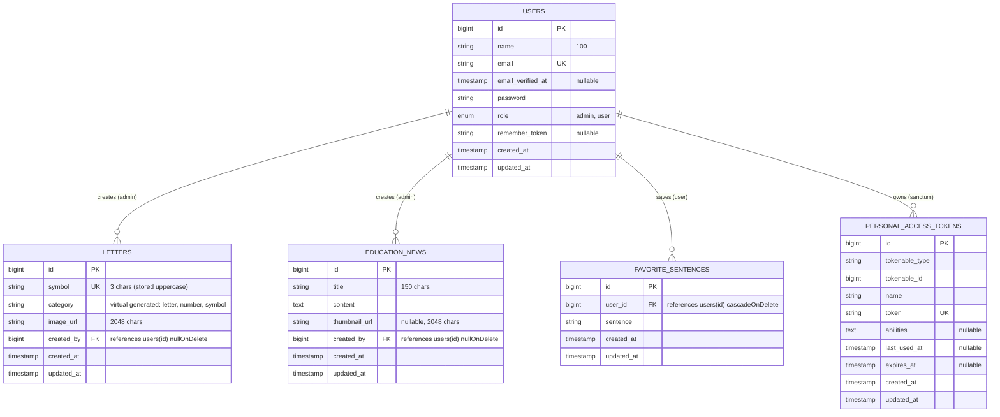
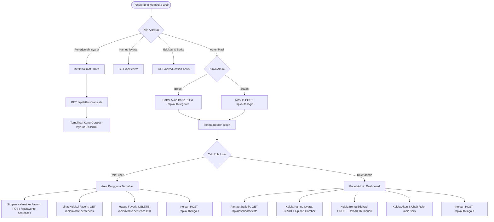

# 🤟 Suara Tangan — Backend REST API (PAWL)

[](https://laravel.com)
[](https://www.php.net/)
[](https://www.mysql.com/)
[](https://laravel.com/docs/sanctum)
[](LICENSE)

> **Suara Tangan** adalah platform pembelajaran dan penerjemah interaktif **Bahasa Isyarat Indonesia (BISINDO)** berbasis web. Repositori ini (`suara-tangan-pawl-be`) merupakan sisi **Backend RESTful API** yang mengelola logika bisnis, autentikasi, manajemen kamus isyarat, portal edukasi, kalimat favorit, dan dashboard analitik admin.

---

## 📌 Daftar Isi
1. [Latar Belakang & Tujuan](#-latar-belakang--tujuan)
2. [Tech Stack](#-tech-stack)
3. [Arsitektur Sistem](#-arsitektur-sistem)
4. [Entity Relationship Diagram (ERD)](#-entity-relationship-diagram-erd)
5. [User Flow & Role Permission](#-user-flow--role-permission)
6. [Fitur Utama](#-fitur-utama)
7. [Dokumentasi REST API](#-dokumentasi-rest-api)
8. [Panduan Instalasi & Menjalankan](#-panduan-instalasi--menjalankan)
9. [Kredensial Default](#-kredensial-default-seeder)
10. [Struktur Direktori](#-struktur-direktori-proyek)

---

## 📖 Latar Belakang & Tujuan

### Latar Belakang
Bahasa Isyarat Indonesia (BISINDO) merupakan jembatan komunikasi utama bagi komunitas Teman Tuli. Namun, media pembelajaran yang interaktif, mudah diakses, dan memiliki visualisasi terstruktur masih sangat terbatas di masyarakat. Banyak orang merasa kesulitan memulai belajar bahasa isyarat karena minimnya kamus visual digital yang responsif serta ketiadaan alat translasi cepat dari teks ke visual alfabet/angka isyarat.

### Tujuan Proyek
Proyek **Suara Tangan** dikembangkan sebagai pemenuhan tugas besar mata kuliah **Pemrograman Aplikasi Web & Lanjut (PAWL)** dengan tujuan:
1. **Inklusivitas Komunikasi:** Menyediakan media digital yang memudahkan masyarakat umum mempelajari BISINDO secara mandiri.
2. **Penerjemah Teks ke Isyarat:** Memetakan karakter, kata, dan angka menjadi visual gerakan tangan BISINDO secara instan.
3. **Portal Informasi & Edukasi:** Menyajikan wawasan dan artikel edukatif seputar budaya Tuli dan bahasa isyarat.
4. **Implementasi Konsep PAWL:** Menerapkan arsitektur web modern *Decoupled / Client-Server* dengan backend REST API (Laravel 12) yang modular, aman (Sanctum RBAC), teroptimasi, dan terintegrasi dengan frontend modern (React + TypeScript).

---

## 💻 Tech Stack

### Backend (`suara-tangan-pawl-be`)
- **Bahasa Pemrograman:** PHP >= 8.2 (Tested on PHP 8.4)
- **Framework:** [Laravel 12](https://laravel.com/)
- **Autentikasi & Autorisasi:** Laravel Sanctum (Token-based API Authentication) & Custom RBAC Middleware
- **Basis Data:** MySQL / MariaDB (InnoDB engine)
- **ORM:** Eloquent ORM dengan Generated Stored Columns
- **Validasi Data:** Laravel Form Requests & Custom Regex Attributes
- **Manajemen File:** Laravel Storage Disk (`public`) untuk upload media isyarat & thumbnail berita
- **Code Standards & Tools:** Laravel Pint, PHPUnit, Composer

### Frontend Pendamping (`suara-tangan-pawl-fe`)
- **Framework:** React 19 + TypeScript + Vite
- **Styling & UI Components:** Tailwind CSS, Radix UI Primitives, Lucide Icons
- **State Management & Data Fetching:** TanStack Query (React Query)
- **Feedback & Feedback UI:** Sonner Toast Notifications

---

## 🏗 Arsitektur Sistem

Aplikasi ini menggunakan pendekatan **Decoupled Client-Server Architecture**:

```
+--------------------------------------------------------+
|             Client / Frontend (React + Vite)           |
|            http://localhost:5173 (Port Dev)            |
+--------------------------------------------------------+
                           |
                           |  HTTP / JSON (REST Requests)
                           |  Authorization: Bearer <Sanctum-Token>
                           v
+--------------------------------------------------------+
|          Backend REST API (Laravel 12 / Sanctum)        |
|            http://localhost:8000 /api/...              |
|                                                        |
|   +-------------------+       +--------------------+   |
|   | Global Middleware | ----> |  Route Middleware  |   |
|   | (ForceJsonResponse|       | (auth:sanctum,     |   |
|   |  Cors, Throttle)  |       |  admin)            |   |
|   +-------------------+       +--------------------+   |
|                                         |              |
|                                         v              |
|                                +------------------+    |
|                                | Controllers (Api)|    |
|                                +------------------+    |
|                                         |              |
|                                         v              |
|                                +------------------+    |
|                                | Eloquent Models  |    |
|                                +------------------+    |
+--------------------------------------------------------+
                           |
             +-------------+-------------+
             |                           |
             v                           v
+-------------------------+ +-------------------------+
|     MySQL Database      | |   Local Storage Disk    |
| (Users, Letters, News,  | | (storage/app/public/    |
|  Favorites, Tokens)     | |  letters & news thumbs) |
+-------------------------+ +-------------------------+
```

---

## 🗄 Entity Relationship Diagram (ERD)



### Detail Aturan Basis Data:
1. **`letters`**: Kolom `category` merupakan *Generated Column* otomatis (`letter`, `number`, atau `symbol`) berdasarkan nilai `symbol`. Simbol disimpan otomatis dalam huruf kapital.
2. **`favorite_sentences`**: Memiliki *Composite Unique Index* `[user_id, sentence]` agar pengguna tidak menduplikasi kalimat favorit yang sama.
3. **`users`**: Memiliki *Role-Based Access Control* (`admin` dan `user`). Penghapusan akun pengguna memicu *cascade delete* pada `favorite_sentences` dan `nullOnDelete` pada `letters` serta `education_news`.

---

## 🔄 User Flow & Role Permission

### 1. Diagram Alur Pengguna (User Flow)



### 2. Matriks Hak Akses (Role-Based Access Control)

| Fitur / Tindakan | Publik / Tamu | User Terdaftar | Administrator |
| :--- | :---: | :---: | :---: |
| Akses Translator BISINDO | ✅ | ✅ | ✅ |
| Melihat Daftar Huruf & Simbol Isyarat | ✅ | ✅ | ✅ |
| Membaca Berita & Artikel Edukasi | ✅ | ✅ | ✅ |
| Registrasi & Login Akun | ✅ | ✅ | ✅ |
| Menyimpan Kalimat Favorit | ❌ | ✅ | ✅ |
| Melihat & Menghapus Kalimat Favorit Sendiri | ❌ | ✅ | ✅ |
| Mengunggah / Mengubah / Menghapus Huruf Isyarat | ❌ | ❌ | ✅ |
| Membuat / Mengubah / Menghapus Berita Edukasi | ❌ | ❌ | ✅ |
| Mengakses Statistik Dashboard Admin | ❌ | ❌ | ✅ |
| Mengubah Role Pengguna / Menghapus Pengguna Lain | ❌ | ❌ | ✅ |

---

## ✨ Fitur Utama

1. **Real-time Sign Translator (Penerjemah Teks ke BISINDO):**
   - Mendukung parsing huruf alfabet (A-Z), angka tunggal/gabungan (0-9, 10, dll.), dan simbol baca.
   - Algoritma pencarian efisien `SignTranslator` dengan sekali kueri SQL `WHERE IN (...)`.
2. **Kamus Isyarat Lengkap (Sign Language Dictionary):**
   - Pengelompokan dinamis: Huruf (*Letters*), Angka (*Numbers*), dan Simbol (*Symbols*).
   - Pengurutan alami (misal: "2" muncul sebelum "10").
3. **Portal Berita & Edukasi BISINDO:**
   - Publikasi artikel edukatif seputar bahasa isyarat, hak disabilitas, dan komunitas Tuli.
   - Dukungan unggah gambar thumbnail dan fallback default thumbnail.
4. **Koleksi Kalimat Favorit Pribadi:**
   - Pengguna dapat menyimpan kalimat yang sering dipelajari.
   - Kalimat favorit otomatis merender kartu visual isyarat tangan pendukungnya.
5. **Admin Management Dashboard:**
   - Metrik total huruf berdasarkan kategori, total user per role, dan ringkasan konten terbaru.
   - CRUD lengkap untuk Kamus Isyarat, Berita, dan Akun Pengguna.
6. **Keamanan & Standar API:**
   - Standar format respons JSON terpadu (`ApiResponse`).
   - Rate limiting pada endpoint sensitif (misal: max 10 percobaan per menit untuk login/register).
   - Sanitasi file upload dan pembersihan otomatis file yatim (*orphaned files*) jika transaksi database gagal.

---

## 📡 Dokumentasi REST API

Semua respons API dibungkus dalam amplop (*envelope*) standar JSON:
```json
{
  "success": true,
  "message": "Pesan deskripsi.",
  "errors": null,
  "data": { ... }
}
```

### 1. Endpoint Autentikasi (`/api/auth`)

| Method | Endpoint | Auth | Keterangan |
| :--- | :--- | :---: | :--- |
| `POST` | `/api/auth/register` | Publik | Registrasi akun baru (`name`, `email`, `password`, `password_confirmation`) |
| `POST` | `/api/auth/login` | Publik | Masuk ke sistem (`email`, `password`) -> Mengembalikan token Sanctum |
| `GET` | `/api/auth/session` | Bearer | Mengambil data pengguna yang sedang login saat ini |
| `POST` | `/api/auth/logout` | Bearer | Menghapus token sesi aktif |

### 2. Endpoint Kamus & Penerjemah Isyarat (`/api/letters`)

| Method | Endpoint | Auth | Keterangan |
| :--- | :--- | :---: | :--- |
| `GET` | `/api/letters` | Publik | Mengambil semua huruf/simbol terdaftar (terurut kategori & alfabet) |
| `GET` | `/api/letters/translate` | Publik | Menerjemahkan kalimat via query param: `?sentence=Halo Dunia` |
| `GET` | `/api/letters/{letter}` | Publik | Mengambil detail satu simbol isyarat |
| `POST` | `/api/letters` | Admin | Menambah simbol baru (Multipart: `symbol`, `image`) |
| `POST` / `PUT`| `/api/letters/{letter}` | Admin | Memperbarui simbol atau mengganti gambar |
| `DELETE` | `/api/letters/{letter}` | Admin | Menghapus simbol isyarat beserta file gambarnya |

### 3. Endpoint Berita Edukasi (`/api/education-news`)

| Method | Endpoint | Auth | Keterangan |
| :--- | :--- | :---: | :--- |
| `GET` | `/api/education-news` | Publik | Mengambil semua berita (terbaru lebih dahulu) |
| `GET` | `/api/education-news/{news}` | Publik | Mengambil detail artikel berita |
| `POST` | `/api/education-news` | Admin | Membuat berita baru (Multipart: `title`, `content`, `thumbnail`) |
| `POST` / `PUT`| `/api/education-news/{news}` | Admin | Memperbarui berita atau mengganti thumbnail |
| `DELETE` | `/api/education-news/{news}` | Admin | Menghapus berita beserta file thumbnail |

### 4. Endpoint Kalimat Favorit (`/api/favorite-sentences`)

| Method | Endpoint | Auth | Keterangan |
| :--- | :--- | :---: | :--- |
| `GET` | `/api/favorite-sentences` | Bearer | Mengambil daftar kalimat favorit milik user aktif + kartu isyaratnya |
| `POST` | `/api/favorite-sentences` | Bearer | Menyimpan kalimat baru ke favorit: `{"sentence": "Terima kasih"}` |
| `DELETE` | `/api/favorite-sentences/{favorite}` | Bearer | Menghapus kalimat favorit |

### 5. Endpoint Admin Dashboard & User Management

| Method | Endpoint | Auth | Keterangan |
| :--- | :--- | :---: | :--- |
| `GET` | `/api/dashboard/stats` | Admin | Statistik agregasi huruf, pengguna, berita, dan aktivitas terbaru |
| `GET` | `/api/users` | Admin | Melihat seluruh data pengguna terdaftar |
| `GET` | `/api/users/{user}` | Admin | Melihat detail satu pengguna |
| `PATCH` | `/api/users/{user}` | Admin | Mengubah role user (`{"role": "admin"}` atau `{"role": "user"}`) |
| `DELETE` | `/api/users/{user}` | Admin | Menghapus akun user (tidak dapat menghapus diri sendiri) |

---

## 🚀 Panduan Instalasi & Menjalankan

### Prasyarat Sistem
- PHP >= 8.2 dengan ekstensi `pdo_mysql`, `mbstring`, `fileinfo`, `openssl`
- [Composer](https://getcomposer.org/) (v2.x)
- MySQL / MariaDB (via XAMPP atau instalasi lokal)
- Node.js (>= 18.x) & npm (untuk menjalankan Frontend)

### Langkah Setup Backend

1. **Masuk ke Direktori Proyek:**
   ```bash
   cd c:\xampp\htdocs\suara-tangan-pawl-be
   ```

2. **Pasang Dependensi PHP via Composer:**
   ```bash
   composer install
   ```

3. **Konfigurasi Environment (`.env`):**
   Salin berkas template lingkungan:
   ```bash
   cp .env.example .env
   ```
   Pastikan pengaturan koneksi database di file `.env` sudah sesuai dengan MySQL Anda:
   ```env
   DB_CONNECTION=mysql
   DB_HOST=127.0.0.1
   DB_PORT=3306
   DB_DATABASE=suara_tangan
   DB_USERNAME=root
   DB_PASSWORD=
   ```
   *(Pastikan database `suara_tangan` sudah dibuat di phpMyAdmin / MySQL).*

4. **Generate Application Key:**
   ```bash
   php artisan key:generate
   ```

5. **Hubungkan Storage Link (Penting untuk upload gambar):**
   ```bash
   php artisan storage:link
   ```

6. **Jalankan Migrasi dan Seeder:**
   ```bash
   php artisan migrate --seed
   ```

7. **Jalankan Server Backend:**
   ```bash
   php artisan serve
   ```
   Backend akan aktif di `http://127.0.0.1:8000`.

---

### Langkah Setup Frontend Pendamping

Buka jendela terminal baru:
```bash
cd c:\xampp\htdocs\suara-tangan-pawl-fe
npm install
npm run dev
```
Buka browser di URL yang tertera (biasanya `http://localhost:5173`).

---

## 🔑 Kredensial Default (Seeder)

Setelah menjalankan `php artisan db:seed`, sistem menyediakan akun default Administrator:

| Parameter | Kredensial |
| :--- | :--- |
| **Email** | `admin@gmail.com` |
| **Password** | `password` |
| **Role** | `admin` |

---

## 📂 Struktur Direktori Proyek

```text
suara-tangan-pawl-be/
├── app/
│   ├── Enums/
│   │   └── UserRole.php              # Enum 'admin' dan 'user'
│   ├── Http/
│   │   ├── Controllers/
│   │   │   └── Api/                  # REST API Controllers (Auth, Letter, News, dll)
│   │   ├── Middleware/               # EnsureUserIsAdmin, ForceJsonResponse
│   │   ├── Requests/                 # Form Requests untuk validasi input
│   │   ├── Resources/                # Eloquent API Resources (Format respons JSON)
│   │   └── Responses/                # Envelope builder standar ApiResponse
│   ├── Models/                       # Eloquent Models (User, Letter, EducationNews, Favorite)
│   └── Support/
│       └── SignTranslator.php        # Helper logika pemetaan kalimat ke simbol BISINDO
├── database/
│   ├── factories/                    # Model factories untuk testing
│   ├── migrations/                   # Skema tabel basis data
│   └── seeders/                      # DatabaseSeeder (Akun default admin)
├── routes/
│   ├── api.php                       # Definisi seluruh rute REST API
│   ├── web.php                       # Rute web standar
│   └── console.php                   # Artisan commands
├── storage/
│   └── app/public/                   # Direktori penyimpanan unggahan media
├── tests/                            # Unit & Feature automated tests
├── .env.example                      # Template variabel lingkungan
├── composer.json                     # Konfigurasi dependensi PHP
└── README.md                         # Dokumentasi lengkap proyek
```

---

## 👥 Kontributor
Proyek ini dikembangkan untuk tugas mata kuliah **Pemrograman Aplikasi Web & Lanjut (PAWL)**.

---
*Dibuat dengan ❤️ untuk inklusivitas dan kemudahan belajar Bahasa Isyarat Indonesia (BISINDO).*
